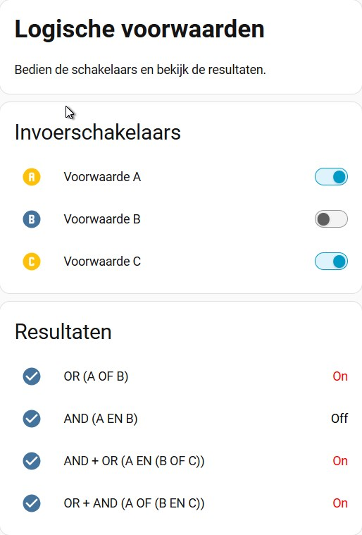

| [Nederlands](README.md) |
|:---:|


[](https://www.home-assistant.io/)
[](Automations.yaml)
[](Dashboard.yaml)


# Home Assistant – Logische voorwaarden: AND, OR en combinaties

Met drie virtuele schakelaars en vier eenvoudige automations laten we zien hoe de voorwaarden **AND (EN)** en **OR (OF)** werken en hoe je deze met elkaar kunt combineren.
Er zijn geen fysieke apparaten of sensoren nodig. Het werkt volledig met `input_boolean`-helpers.

<p align="center">
  
</p>


Om dit te testen in je eigen Home Assistant maak je zeven input_boolean-helpers aan.
Je kunt dit via Instellingen → Apparaten en diensten → Helpers doen, of via YAML.

Zie hoofdstuk 7 welke helpers je aan moet maken.

---

<br>

## 1. Waarom gaan we hiermee aan de slag?

Binnen Home Assistant bepalen voorwaarden of een automation wel of niet wordt uitgevoerd. De twee belangrijkste bouwstenen hiervoor zijn AND (EN) — waarbij alles waar moet zijn — en OR (OF) — waarbij minimaal één voorwaarde moet kloppen.

Door deze slim te combineren, kun je jouw smart home complexe beslissingen laten nemen. Om precies te laten zien hoe dit in de praktijk werkt, maakt dit project de logica inzichtelijk aan de hand van vier afzonderlijke demonstraties. 

## 2. AND (EN)

Bij een AND-voorwaarde moeten alle voorwaarden waar zijn.

Voorbeeld:

Een lamp mag alleen inschakelen als:

- Schakelaar A aanstaat.
- Schakelaar B aanstaat.

De logica:

`A AND B`

| A | B | Resultaat |
|---|---|---|
| Uit | Uit | Onwaar |
| Uit | Aan | Onwaar |
| Aan | Uit | Onwaar |
| Aan | Aan | Waar |

In Home Assistant:

```yaml
- condition: and
  conditions:
    - condition: state
      entity_id: input_boolean.voorwaarde_a
      state: "on"

    - condition: state
      entity_id: input_boolean.voorwaarde_b
      state: "on"
```

Beide voorwaarden moeten voldoen voordat de automation verdergaat.

## 3. OR (OF)

Bij een OR-voorwaarde hoeft slechts één van de voorwaarden waar te zijn.

Voorbeeld:

Een lamp mag inschakelen als:

- Schakelaar A aanstaat.
- OF schakelaar B aanstaat.

De logica:

`A OR B`

| A | B | Resultaat |
|---|---|---|
| Uit | Uit | Onwaar |
| Uit | Aan | Waar |
| Aan | Uit | Waar |
| Aan | Aan | Waar |

In Home Assistant:

```yaml
- condition: or
  conditions:
    - condition: state
      entity_id: input_boolean.voorwaarde_a
      state: "on"

    - condition: state
      entity_id: input_boolean.voorwaarde_b
      state: "on"
```

Zodra één van de voorwaarden voldoet, kan de automation verdergaan.

## 4. Triggers en conditions: het verschil

Het is belangrijk om onderscheid te maken tussen **triggers** en **conditions** binnen Home Assistant.
Ze hebben allebei een eigen functie binnen een automation.

**Triggers bepalen wanneer een automation wordt gestart.**

Wanneer je meerdere triggers opgeeft, is het voldoende dat één van deze triggers optreedt om de automation te starten. Dit werkt dus standaard als OR (OF).

Voorbeeld:

```yaml
triggers:
  - trigger: state
    entity_id: input_boolean.voorwaarde_a
    to: "on"

  - trigger: state
    entity_id: input_boolean.voorwaarde_b
    to: "on"
```

De automation wordt gestart wanneer schakelaar A OF schakelaar B wordt ingeschakeld.

**Conditions bepalen of de automation daadwerkelijk verder mag worden uitgevoerd.**

Hier kun je expliciet gebruikmaken van AND (EN), OR (OF) of een combinatie van beide.
Wanneer je meerdere conditions opgeeft, worden deze standaard met AND (EN) gecombineerd. Alle voorwaarden moeten dan waar zijn.
Wil je hiervan afwijken, dan kun je `condition: or` gebruiken. Daarmee geef je aan dat minimaal één van de onderliggende voorwaarden waar moet zijn.

**Belangrijk:** AND en OR zijn dus geen afzonderlijke instellingen bij triggers. Je gebruikt deze logische constructies binnen het onderdeel `conditions` om te bepalen of een automation na het starten daadwerkelijk acties mag uitvoeren.


## 5. AND en OR combineren

De echte kracht van logische voorwaarden ontstaat wanneer je AND en OR combineert.
Hieronder staan twee combinaties die op het eerste gezicht op elkaar lijken, maar een verschillende uitkomst kunnen geven.

### 5.1 A AND (B OR C)

Voorwaarde A moet waar zijn én minimaal één van de voorwaarden B of C moet waar zijn.

De logica:

`A AND (B OR C)`

In Home Assistant:

```yaml
- condition: and
  conditions:
    - condition: state
      entity_id: input_boolean.voorwaarde_a
      state: "on"

    - condition: or
      conditions:
        - condition: state
          entity_id: input_boolean.voorwaarde_b
          state: "on"

        - condition: state
          entity_id: input_boolean.voorwaarde_c
          state: "on"
```

### 5.2 A OR (B AND C)

Voorwaarde A moet waar zijn óf zowel B als C moeten waar zijn.

De logica:

`A OR (B AND C)`

In Home Assistant:

```yaml
- condition: or
  conditions:
    - condition: state
      entity_id: input_boolean.voorwaarde_a
      state: "on"

    - condition: and
      conditions:
        - condition: state
          entity_id: input_boolean.voorwaarde_b
          state: "on"

        - condition: state
          entity_id: input_boolean.voorwaarde_c
          state: "on"
```

## 6. Vergelijking van alle combinaties

De onderstaande tabel laat zien wat de vier verschillende logische constructies opleveren.

`1` betekent waar (aan).  
`0` betekent onwaar (uit).

| A | B | C | A OF B | A EN B | A EN (B OF C) | A OF (B EN C) |
|---|---|---|---|---|---|---|
| 0 | 0 | 0 | 0 | 0 | 0 | 0 |
| 0 | 0 | 1 | 0 | 0 | 0 | 0 |
| 0 | 1 | 0 | 1 | 0 | 0 | 0 |
| 0 | 1 | 1 | 1 | 0 | 0 | 1 |
| 1 | 0 | 0 | 1 | 0 | 0 | 1 |
| 1 | 0 | 1 | 1 | 0 | 1 | 1 |
| 1 | 1 | 0 | 1 | 1 | 1 | 1 |
| 1 | 1 | 1 | 1 | 1 | 1 | 1 |

Een interessante situatie is:

- A = Uit
- B = Aan
- C = Aan

Bij `A AND (B OR C)` is het resultaat onwaar.

Bij `A OR (B AND C)` is het resultaat waar.

Dit laat duidelijk zien dat de volgorde en de groepering van voorwaarden bepalend zijn voor de uitkomst.

## 7. Home Assistant-configuratie

Voor dit project worden drie invoerschakelaars en vier resultaathelpers gebruikt.

### Invoerschakelaars

| Entity | Functie |
|---|---|
| `input_boolean.voorwaarde_a` | Voorwaarde A |
| `input_boolean.voorwaarde_b` | Voorwaarde B |
| `input_boolean.voorwaarde_c` | Voorwaarde C |

### Resultaathelpers

| Entity | Functie |
|---|---|
| `input_boolean.resultaat_or` | Uitkomst A OR B |
| `input_boolean.resultaat_and` | Uitkomst A AND B |
| `input_boolean.resultaat_and_or` | Uitkomst A AND (B OR C) |
| `input_boolean.resultaat_or_and` | Uitkomst A OR (B AND C) |

De vier automations reageren op wijzigingen van de drie invoerschakelaars.
Afhankelijk van de ingestelde voorwaarden wordt de bijbehorende resultaathelper ingeschakeld of uitgeschakeld.
Ook na een herstart van Home Assistant worden de resultaten opnieuw berekend.

## 8. Dashboard

Het dashboard bestaat uit twee onderdelen:

**Invoerschakelaars**

Hiermee kunnen de drie voorwaarden handmatig worden bediend.

**Resultaten**

Hier worden de vier uitkomsten weergegeven.
Door verschillende combinaties te proberen, wordt direct zichtbaar welke logische voorwaarden waar zijn.
Er is geen aanvullende hardware of integratie nodig.

## 9. En wat hebben we nu ontdekt?

AND en OR vormen de basis van vrijwel elke slimme automatisering in Home Assistant. Of nu álle voorwaarden moeten kloppen (AND) of slechts eentje voldoende is (OR): door ze slim te combineren, krijg je volledige controle over wanneer een automation start. Met de drie virtuele schakelaars uit dit project heb je nu een simpele, tastbare manier in handen om zelfs de meest complexe logica te begrijpen en te testen.

